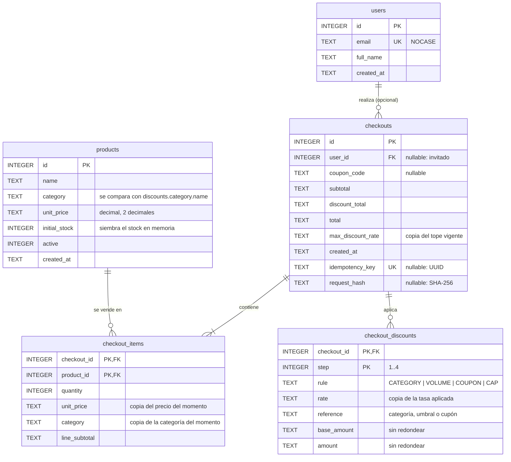

# schema

Esquema SQLite del checkout: usuarios, catálogo de productos, órdenes confirmadas y desglose de los descuentos aplicados.

| Archivo | Contenido |
|---|---|
| `schema.sql` | Tablas, índices y vista. Es idempotente (`IF NOT EXISTS`), así que se puede ejecutar en cada arranque. |
| `seed.sql` | Datos de demostración: 2 usuarios y 6 productos, uno de ellos sin stock. |
| `scripts/verify.sh` | Prueba del esquema: un checkout válido se acepta y los datos corruptos se rechazan. |

```bash
packages/schema/scripts/verify.sh
```

Requiere `sqlite3` 3.37 o superior, la versión que introdujo las tablas `STRICT`.

## Modelo



`checkout_items` es la tabla pivote entre `checkouts` y `products`. Los descuentos van en una tabla aparte porque solo el de categoría es por línea; el de volumen, el cupón y el tope se aplican a la orden completa. Repetirlos o prorratearlos en cada línea complicaría la auditoría sin aportar nada.

## Tablas

### `users`

| Columna | Tipo | Reglas |
|---|---|---|
| `id` | INTEGER | PK |
| `email` | TEXT | Obligatorio, único sin distinguir mayúsculas (`COLLATE NOCASE`) y con forma `x@y`. |
| `full_name` | TEXT | Obligatorio y no vacío. |
| `created_at` | TEXT | ISO-8601 UTC, se asigna por defecto. |

No hay columna de contraseña: la autenticación no está en el alcance. Si se agrega, se guarda un hash (Argon2 o bcrypt), nunca el texto plano.

### `products`

| Columna | Tipo | Reglas |
|---|---|---|
| `id` | INTEGER | PK. Es el `productId` que envía el cliente. |
| `name` | TEXT | Obligatorio y no vacío. |
| `category` | TEXT | Obligatoria. El motor la compara con `discounts.category.name`. |
| `unit_price` | TEXT | Decimal con exactamente 2 decimales y mayor que 0. Es la única fuente de precios. |
| `initial_stock` | INTEGER | Mayor o igual a 0. Solo siembra el stock en memoria. |
| `active` | INTEGER | 0 o 1. Un producto vendido no se borra; se desactiva. |
| `created_at` | TEXT | ISO-8601 UTC. |

### `checkouts`

Cabecera de la orden confirmada. Los tres montos son totales finales redondeados `HALF_EVEN` a 2 decimales.

| Columna | Tipo | Reglas |
|---|---|---|
| `id` | INTEGER | PK |
| `user_id` | INTEGER | FK a `users`, opcional (checkout de invitado). `ON DELETE RESTRICT`. |
| `coupon_code` | TEXT | Cupón aplicado, o NULL. Un cupón inválido no llega aquí: se rechaza antes con Problem Details. |
| `subtotal` | TEXT | Suma de las líneas, mayor que 0. |
| `discount_total` | TEXT | Descuento final. |
| `total` | TEXT | `subtotal - discount_total` (lo verifica un `CHECK`). |
| `max_discount_rate` | TEXT | Copia de `discounts.max-total-rate` vigente. `discount_total` no puede superar `subtotal × max_discount_rate` (con medio centavo de tolerancia por el redondeo final). |
| `created_at` | TEXT | ISO-8601 UTC. |
| `idempotency_key` | TEXT | Header `Idempotency-Key` de `POST /checkouts`: UUID en minúsculas, `UNIQUE`, o NULL si no se envió. Varios NULL no chocan. |
| `request_hash` | TEXT | SHA-256 hexadecimal del request normalizado. Obligatorio si hay clave y NULL si no (lo verifica un `CHECK`). |

Una clave repetida con el mismo `request_hash` es un reintento: el backend devuelve la orden guardada. Con otro hash, responde `IDEMPOTENCY_KEY_REUSED`.

> Las columnas de idempotencia están en el `CREATE TABLE`. Como no hay migraciones, una base local creada antes de este cambio no las tiene: hay que borrar `apps/backend/data/checkout.db` para que se recree.

### `checkout_items` (pivote)

| Columna | Tipo | Reglas |
|---|---|---|
| `checkout_id` | INTEGER | PK y FK a `checkouts`, `ON DELETE CASCADE`. |
| `product_id` | INTEGER | PK y FK a `products`, `ON DELETE RESTRICT`. |
| `quantity` | INTEGER | Mayor que 0. |
| `unit_price` | TEXT | Copia del precio del catálogo al confirmar. |
| `category` | TEXT | Copia de la categoría al confirmar. Hace auditable el descuento de categoría. |
| `line_subtotal` | TEXT | `unit_price × quantity`, verificado por un `CHECK`. |

La PK compuesta impide que un producto aparezca dos veces en el mismo checkout. Si el carrito llega con duplicados, el backend consolida las cantidades antes de guardar.

### `checkout_discounts`

Un registro por cada paso de la cascada que tuvo efecto. Un paso que no aplica, como el de volumen cuando no se supera el umbral, no genera registro.

| `step` | `rule` | `rate` | `reference` | `base_amount` | `amount` |
|---|---|---|---|---|---|
| 1 | `CATEGORY` | `discounts.category.rate` | nombre de la categoría | subtotal de las líneas de esa categoría | descuento |
| 2 | `VOLUME` | `discounts.volume.rate` | umbral | subtotal tras categoría | descuento |
| 3 | `COUPON` | `discounts.coupon.rate` | código del cupón | monto tras volumen | descuento |
| 4 | `CAP` | `discounts.max-total-rate` | NULL | descuento acumulado antes del tope | exceso recortado |

- Un `CHECK` amarra cada regla a su paso, así que el orden de precedencia no se puede alterar al guardar.
- `base_amount` y `amount` se guardan **sin redondear**, porque la regla es redondear solo los totales finales.
- Se cumple que `discount_total = round_HALF_EVEN(Σ pasos 1..3 − CAP, 2)`.

### Vista `checkout_summary`

Resumen de cada checkout con `cap_applied`, que vale 1 si existe el paso `CAP`, e `item_count`. Alimenta la alerta de HU4 sin guardar el indicador dos veces.

## Ejemplo

Carrito: 2 laptops de 1200.00 (Tecnología) y 1 lámpara de 40.00 (Hogar), con cupón `WELCOME2026` y los valores actuales de `application.yml`.

| Paso | Base | Tasa | Descuento | Acumulado |
|---|---|---|---|---|
| Subtotal | | | | 2440.00 |
| CATEGORY | 2400.00 | 0.10 | 240.00 | 2200.00 |
| VOLUME (2200 > 100) | 2200.00 | 0.05 | 110.00 | 2090.00 |
| COUPON | 2090.00 | 0.15 | 313.50 | 1776.50 |
| CAP (663.50 ≤ 35% de 2440 = 854.00) | | | no aplica | |

Se guarda: `checkouts(subtotal='2440.00', discount_total='663.50', total='1776.50', max_discount_rate='0.35')`, dos filas en `checkout_items` y tres en `checkout_discounts`. Es el caso válido de `scripts/verify.sh`.

## Decisiones

| Decisión | Elegido | Alternativa descartada | Razón |
|---|---|---|---|
| Representación del dinero | `TEXT` con el decimal exacto | `REAL`; `INTEGER` en centavos | SQLite no tiene `DECIMAL`. `REAL` es punto flotante y rompe la regla de `BigDecimal`. Los centavos obligarían a redondear cada monto intermedio, cuando la regla dice que solo se redondean los totales finales. Con `TEXT`, `new BigDecimal(rs.getString(...))` reconstruye el valor exacto. |
| Tipos estrictos | Tablas `STRICT` | Tipado dinámico de SQLite | Sin `STRICT`, SQLite aceptaría `10.5` (REAL) en una columna de dinero. Con `STRICT` lo rechaza. |
| Stock | `initial_stock` solo para sembrar | Stock vivo en la base | `arquitectura.md` y HU3 exigen stock en memoria con decremento atómico. Una columna que se actualiza crearía dos fuentes de verdad. |
| Usuario del checkout | `user_id` opcional | Obligatorio | El contrato dice que el cliente solo envía `productId`, cantidad y cupón, y no hay autenticación. Ser opcional permite checkouts de invitado y no rompe esa regla. |
| Estructura del checkout | Cabecera + pivote + descuentos | Solo pivote con columnas de descuento | Los descuentos de volumen, cupón y tope son de la orden, no de cada línea. |
| Valores de las reglas | Copia por checkout (tasas, umbral, cupón, tope) | Fijarlos en `CHECK` o en una tabla de reglas | La regla dice que los valores salen de `discounts.*`. Guardar una copia hace auditable una orden aunque la configuración cambie después. |
| Copia de precio y categoría en la línea | Sí | Leerlos siempre del catálogo | Si el precio cambia, la orden histórica no debe cambiar. |
| Borrado | `RESTRICT` sobre productos y usuarios; `CASCADE` de la cabecera a sus líneas y descuentos | `CASCADE` general | Una orden es un registro financiero: borrar un producto no debe borrar ventas. |
| Guardas con `CAST(... AS REAL)` | Solo dentro de los `CHECK`, con tolerancia | Triggers con aritmética decimal | SQLite no tiene aritmética decimal exacta. Las guardas detectan datos corruptos, pero el cálculo autoritativo es el del dominio con `BigDecimal`. |

## Integración con el backend

`apps/backend` ejecuta estos scripts al arrancar y persiste cada checkout en estas tablas.

| Pieza | Dónde | Qué hace |
|---|---|---|
| Empaquetado de los scripts | `apps/backend/pom.xml` (`<resources>`) | Maven copia `schema.sql` y `seed.sql` a `classpath:db/` al compilar. |
| Ejecución al arrancar | `application.yml`, `spring.sql.init` | `mode: always` (SQLite no se detecta como base embebida, así que con el valor por defecto no se ejecutarían), `schema-locations: classpath:db/schema.sql`, `data-locations: classpath:db/seed.sql`, `encoding: UTF-8`. Los dos scripts son idempotentes. |
| Llaves foráneas | `spring.datasource.url` | `jdbc:sqlite:${APP_DB_PATH:./data/checkout.db}?foreign_keys=true`. sqlite-jdbc aplica el `PRAGMA` en cada conexión del pool; el de `schema.sql` solo afecta a la conexión que ejecuta el script. |
| Errores de SQLite | `apps/backend/src/main/resources/sql-error-codes.xml` | Traduce `SQLITE_CONSTRAINT` (19) a `DataIntegrityViolationException`. Sin él, Spring entrega `UncategorizedSQLException`, porque no trae códigos para SQLite y sqlite-jdbc no informa SQLState. |
| Escritura del checkout | `infrastructure/persistence/JdbcOrderRepository` (puerto `domain/port/OrderRepository`) | Cabecera, `checkout_items` y `checkout_discounts` en una sola transacción (`@Transactional`). Si falla cualquier fila (FK, `CHECK`), no queda una orden a medias. |
| Dinero | `JdbcOrderRepository` | Se escribe con `BigDecimal.toPlainString()` y se lee con `new BigDecimal(rs.getString(...))`. Conserva la escala: `'2090.0000'` vuelve como `2090.0000`. Nunca pasa por `double`. |
| Stock en memoria | `JdbcInitialStockSource` → `config/StockConfig` → `stock/InMemoryStockRepository` | Al arrancar se lee `initial_stock` de los productos activos y se siembra el stock en memoria, que se descuenta de forma atómica por producto. La base no se vuelve a tocar. |

### Decisión: los scripts se empaquetan desde aquí, no se copian ni se referencian por ruta

| Opción | Resultado |
|---|---|
| Copiarlos a `apps/backend/src/main/resources` | Descartada: dos copias del mismo esquema que se desincronizan, y `scripts/verify.sh` probaría una distinta de la que usa el backend. |
| Referenciarlos con `file:../../packages/schema/schema.sql` | Descartada: depende del directorio de trabajo y deja de funcionar al ejecutar el `.jar`. |
| **Empaquetarlos en `classpath:db/` desde `pom.xml`** | **Elegida:** este paquete sigue siendo la única fuente de verdad, el `.jar` es autocontenido y `spring.sql.init` los lee del classpath. Cualquier cambio aquí llega al backend en el siguiente `mvn` (en el IDE, tras recompilar o reimportar Maven). |

Si más adelante se adopta Flyway, `schema.sql` pasa a ser la migración `V1` y `spring.sql.init` se retira.

### Errores hacia el cliente

`api/ApiExceptionHandler` traduce los errores de persistencia a Problem Details. El detalle completo queda en el log; la respuesta nunca lleva el mensaje de SQLite, el SQL ni la traza.

| Excepción | HTTP | `code` |
|---|---|---|
| `DataIntegrityViolationException` (FK o `CHECK`) | 422 | `DATA_INTEGRITY_VIOLATION` |
| `DataAccessResourceFailureException`, `PessimisticLockingFailureException` (base inaccesible, `SQLITE_BUSY`/`SQLITE_LOCKED`) | 503 | `DATABASE_UNAVAILABLE` |
| Cualquier otro `DataAccessException` (incluido un monto corrupto al leer) | 500 | `PERSISTENCE_ERROR` |
| `InsufficientStockException` | 409 | `INSUFFICIENT_STOCK` |

Un monto NULL o que no es decimal se lee como `DataRetrievalFailureException` (ver `SqliteMoney`), no como `NumberFormatException`.

**No hay fallback ante una base caída:** el arranque falla rápido y, en ejecución, cada petición responde 503 sin reintentar. Ver "Pendiente".

### Pruebas

Las pruebas de integración (`JdbcOrderRepositoryTest`, `SiembraDeStockTest`) arrancan Spring con la configuración real sobre un archivo SQLite temporal; solo cambian `APP_DB_PATH`. Cubren:

- carga del esquema y del seed, y `PRAGMA foreign_keys = 1` en la conexión del pool;
- persistencia completa (cabecera, líneas, descuentos) y lectura con los mismos montos y escalas;
- montos sin redondear guardados como `text`;
- checkout de invitado sin cupón ni descuentos, y paso `CAP` reflejado en `checkout_summary.cap_applied`;
- rechazo por FK de un producto o un usuario inexistente, sin filas residuales;
- rollback de cabecera y líneas cuando falla el último insert (un `CHECK` de `checkout_discounts`);
- siembra del stock desde `initial_stock`, incluido el producto 6 sin stock.

Además, sin Spring o con una base aislada:

- `ConexionYEsquemaTest`: URL con `foreign_keys=true`, PRAGMA activo en una conexión nueva del driver, pool de 1, SQLite ≥ 3.37, tablas `STRICT`, re-ejecución idempotente de los scripts y scripts empaquetados idénticos a los de este paquete;
- `SqliteMoneyTest`: ida y vuelta exacta con su escala, sin notación científica, sin `getDouble`, y montos corruptos o nulos;
- `JdbcInitialStockSourceTest`: catálogo vacío, `initial_stock = 0` y productos inactivos;
- `TraduccionDeErroresSqliteTest`: los códigos 19, 5 y 6 de `sql-error-codes.xml`;
- `BaseDeDatosNoDisponibleTest`: guardar, leer y sembrar sin base lanzan `DataAccessException`, y la aplicación no arranca;
- `ApiExceptionHandlerTest`: cada error llega con su `status` y `code`, sin filtrar el mensaje interno;
- datos corruptos al escribir: más de 2 decimales, descuento por encima del tope (y exactamente en el tope) y monto negativo.

### Pendiente

- **Normalizar las categorías a Unicode NFC.** `'Tecnología'` con tilde precompuesta y con tilde combinada son cadenas distintas para SQLite. Corresponde a la lectura del catálogo, que aún no existe.
- **Fallbacks que no existen.** No hay reintento ante `SQLITE_BUSY` (con un pool de 1 conexión es poco probable, pero se puede agregar `busy_timeout` a la URL), ni modo degradado si la base no abre al arrancar (hoy falla rápido, que es lo deseable para una orden financiera).
- **Liberar stock si falla la persistencia.** El puerto de stock solo reserva; el caso de uso de checkout decidirá cómo compensar.

## Casos de borde que resuelve el dominio, no el esquema

| Caso | Dónde se resuelve | Qué aporta el esquema |
|---|---|---|
| Carrito vacío | Dominio, que lo rechaza antes de guardar | `subtotal > 0` y `quantity > 0` |
| Datos corruptos | Validación de entrada en la API | Tipos `STRICT`, formato decimal, FK y `CHECK` |
| Cupón no registrado | Dominio, contra `discounts.coupon.code` | Solo se guarda el cupón aplicado |
| Cupón expirado | **Pendiente:** `discounts.coupon` no tiene fecha de expiración | — |
| Stock insuficiente | Adaptador de stock en memoria | El producto 6 del seed tiene `initial_stock = 0` para la demo |
| Tope del 35% superado | Dominio | Paso `CAP`, `max_discount_rate` y el `CHECK` de tope |
